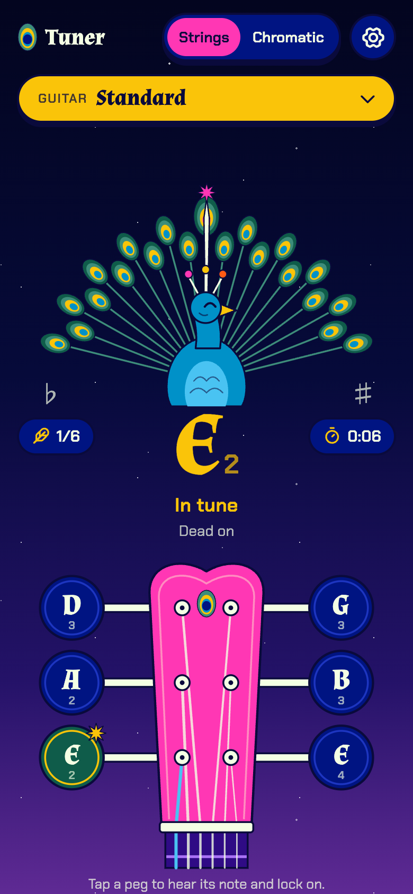

# Pav Tuner

An open source tuner for guitar, bass and ukulele. Every tuning is unlocked: Drop D, DADGAD, open tunings, half step down and more. No ads, no account, no paywall.

**Live: https://tuner.pav.cz**

<p>
  
  
</p>

## How it works

1. Pick your tuning.
2. Pluck a string. The tuner works out which string it is, and the peacock's tail shows how far off you are: blue feathers mean too low, pink feathers mean too high.
3. Hold the note in tune for a moment and the string locks in. Lock all of them to finish. Your best time per tuning is saved on your device.

Tap a peg to hear the reference note and pin the tuner to that string. Switch to **Chromatic** to tune to any note. Concert pitch (A4) is adjustable in settings.

Audio never leaves the device. There is no backend, no analytics and no cookies.

## Tunings

| Instrument | Tunings |
| --- | --- |
| Guitar | Standard, Drop D, Half Step Down, D Standard, Drop C#, Drop C, Drop B, Double Drop D, DADGAD, Open G, Open D, Open E, Open C, Open A |
| Bass | Standard, Drop D, Half Step Down, D Standard |
| Ukulele | Standard, Low G, Baritone |

Adding one is a single line in [`public/js/tunings.js`](public/js/tunings.js). Pull requests welcome.

## Development

No build step. It is plain HTML, CSS and ES modules.

```sh
npm install
npm run dev      # local server (microphone needs localhost or HTTPS)
npm test         # pitch detection tests
npm run deploy   # deploy to Cloudflare Workers
```

| Path | What it is |
| --- | --- |
| `public/js/pitch.js` | YIN pitch detection, pure function, tested in Node |
| `public/js/tunings.js` | Instruments, tunings and note maths |
| `public/js/app.js` | Tuner logic, game state, UI wiring |
| `public/js/scene.js` | SVG scenery: tail fan meter and headstock |
| `public/js/audio.js` | Microphone input and synthesised sounds |
| `public/js/fx.js` | Particle bursts |
| `public/sw.js` | Offline cache, so it works as an installed app |

## Install on a phone

Open the site, then **Share > Add to Home Screen** (iOS) or **Install app** (Android). It runs full screen and works offline.

## Credits

- Fonts: [Almendra](https://fonts.google.com/specimen/Almendra) and [Chakra Petch](https://fonts.google.com/specimen/Chakra+Petch), both SIL Open Font License.
- Icons: [Phosphor](https://phosphoricons.com), MIT.
- Pitch detection follows the YIN paper by de Cheveigne and Kawahara (2002).

Pav is Czech for peacock.

## License

[MIT](LICENSE)
